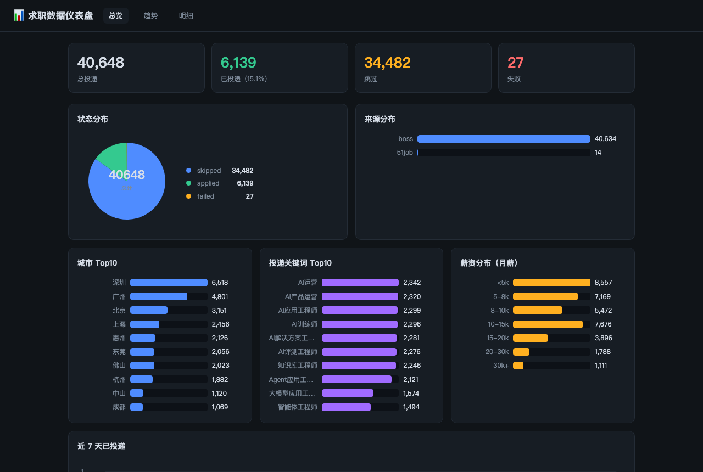
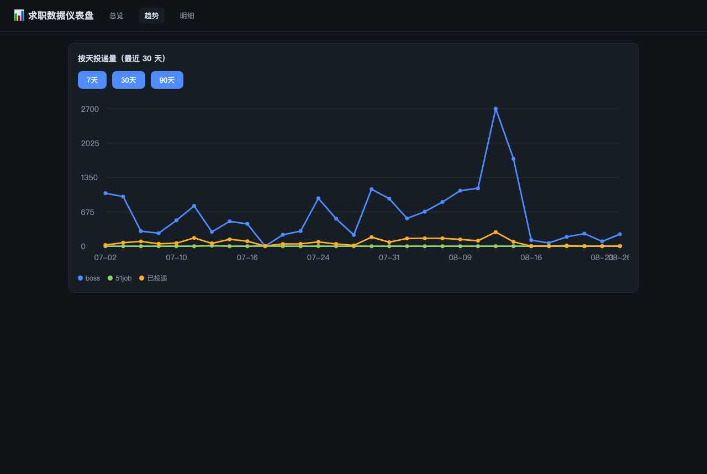

# 📊 求职数据仪表盘

一个本地运行的 Web 应用：把自动化求职流程产生的 **4.7 万条岗位判定记录**变成可视化仪表盘——总览、趋势、明细筛选。用于看清"投了什么、投到哪、结果如何"，用数据代替感觉做求职决策。

<p align="center">
  <b>🌐 AI 智能求职全链路套件 (Job Intelligence Suite)</b><br>
  <a href="https://github.com/Liooo0/boss-zhipin-helper">🧩 浏览器扩展 (JD即时提炼/AI回复)</a>
  &nbsp;•&nbsp;
  <a href="https://github.com/Liooo0/job-hunter">🎯 Job Hunter (规则引擎/精准拟真投递)</a>
  &nbsp;•&nbsp;
  <b>📊 决策仪表盘 (4.7 万条岗位判定记录)</b>
</p>

<p align="center">
  
  
  
  
</p>

> 深色主题 · 零构建原生前端 · FastAPI + SQLite（只读）· 自写 SVG 图表（零依赖）

## ⚡ 3 分钟跑起来（无需真实数据）

仓库内置一份**合成脱敏 demo 数据**（1200 行，`demo/jobintel_demo.db`，由 `scripts/make_demo_db.py` 生成），clone 后即可看到完整仪表盘：

```bash
git clone https://github.com/Liooo0/jobintel-dashboard.git
cd jobintel-dashboard
pip install -r requirements.txt
python3 scripts/make_demo_db.py   # 可选：重新生成 demo 数据（固定 seed，可复现）
uvicorn app:app --port 8001
```

打开 <http://127.0.0.1:8001>，总览 / 趋势 / 明细三个页面都有数据。健康检查：

```bash
curl -s http://127.0.0.1:8001/api/healthz
# {"ok":true,"db":".../demo/jobintel_demo.db","source":"demo","rows":1200}
```

数据库解析优先级（详见「数据源」）：`JOBINTEL_DB` → 本机真实库 `../jobintel/data/jobintel.db` → 内置 `demo/jobintel_demo.db` → 明确报错。**外部 clone 没有第 2 条路径，会自动落到内置 demo（`source=demo`）**；开发者本机若存在真实库则沿用旧行为（`source=local`），不会被 demo 静默顶替。

> ⚠️ demo 数据全部由程序合成：公司名（如「星辰科技」「云澜数据」）、岗位名、关键词都来自仓库内自造词表，薪资 / 时间 / 状态分布参考真实库的聚合统计；**真实求职记录（含公司名、岗位名、HR 聊天内容）不入库、不公开**。需要看真实数据时用 `JOBINTEL_DB` 指向本地真实库（见「数据源」）。

## 🐳 Docker（一键起）

```bash
docker build -t jobintel-dashboard .
docker run --rm -p 8001:8001 jobintel-dashboard
# 或者
docker compose up --build
```

构建时会自动生成 demo 数据，容器自带 `HEALTHCHECK`（探测 `/api/healthz`）。

> 说明：`Dockerfile` / `docker-compose.yml` 只做了静态检查——开发机没有 Docker，**未实际执行 build**；首次使用请以构建日志为准。

## 界面截图





## 功能

| 页面 | 内容 |
| --- | --- |
| 📊 总览 `/` | KPI（总投递/已投/跳过/失败）、状态环形图、来源/城市/关键词 Top10、薪资分布直方图、近7天投递折线 |
| 📈 趋势 `/trend` | 按天投递量折线（来源拆分 + 已投递数），7/30/90 天切换 |
| 📋 明细 `/detail` | 全字段表格 + 城市/来源/状态/关键词筛选 + 分页 |

## 数据源

数据库按以下优先级解析，`/api/healthz` 的 `source` 字段会如实返回 `env` / `local` / `demo`：

| 优先级 | 来源 | 路径 | `source` | 说明 |
| --- | --- | --- | --- | --- |
| 1 | 环境变量 | `$JOBINTEL_DB` | `env` | 显式指定；文件不存在直接报错，不静默降级 |
| 2 | 本机真实库 | `../jobintel/data/jobintel.db` | `local` | 开发者机器上的旧默认路径，存在即使用；公开 clone 没有它 |
| 3 | 内置 demo 库 | `demo/jobintel_demo.db` | `demo` | 合成脱敏数据，外部 clone 默认落到这里 |
| 4 | — | — | — | 都没有：报错并提示 `python3 scripts/make_demo_db.py` |

- **demo（仓库内置，外部 clone 默认）**：`demo/jobintel_demo.db`，1200 行合成脱敏数据，由 `scripts/make_demo_db.py` 生成（固定 `seed=20260801`，可复现），不含任何真实记录。
- **真实库**：只读 `jobintel/data/jobintel.db`（由自动化投递脚本写入，仪表盘永不改数据）。该库是个人求职隐私数据，不进公开仓库；本机自动沿用，其他机器用环境变量 `JOBINTEL_DB` 指定。

数据同步以投递主库 `~/projects/job-hunter/ab_experiment.db` 为准（JSON 日志 2026-08 起停更），更新数据：

```bash
cd ~/projects/jobintel && python3 src/sync_from_main_db.py
```

```sql
applications(id, source, status, city, company, job,
             salary_raw, salary_min_k, salary_max_k, salary_unit, salary_months,
             score, keyword, reason, error, ts)
```

## 运行

```bash
cd ~/projects/jobintel-dashboard
python3 -m venv venv && source venv/bin/activate
pip install -r requirements.txt
uvicorn app:app --host 127.0.0.1 --port 8001
```

打开 <http://127.0.0.1:8001>。数据库解析顺序：`JOBINTEL_DB` → 本机真实库 `../jobintel/data/jobintel.db` → 内置 `demo/jobintel_demo.db` → 报错并提示 `python3 scripts/make_demo_db.py`。本机若无真实库才会用合成 demo 数据；显式指定真实数据：

```bash
JOBINTEL_DB=~/projects/jobintel/data/jobintel.db uvicorn app:app --host 127.0.0.1 --port 8001
```

接口：`GET /api/overview`、`/api/trend`、`/api/detail`、`/api/healthz`（健康检查，返回当前使用的 DB 路径与来源 `env`/`local`/`demo`）。

## 技术说明

- **只读安全**：所有查询是 `SELECT`，连接即用即关
- **图表零依赖**：donut/bar/line 全部自写 SVG 渲染，无 CDN、离线可用
- **薪资归一化**：K / 万 / 元/月 / 元/天 统一折算为月薪（K）再分桶
- 与 [llm-arena](https://github.com/Liooo0/llm-arena) 同款技术栈（FastAPI + 原生前端 + SQLite），面试可讲同一套故事

## 需求与迭代

详见 [docs/requirements.md](docs/requirements.md)（v0.2 规划：面试反馈录入 → 漏斗图 → 周报自动生成）。

## 安全

纯本地运行；若暴露到局域网/公网，需先加鉴权（参考 llm-arena 的 `LLM_ARENA_ADMIN_TOKEN` 模式）。
